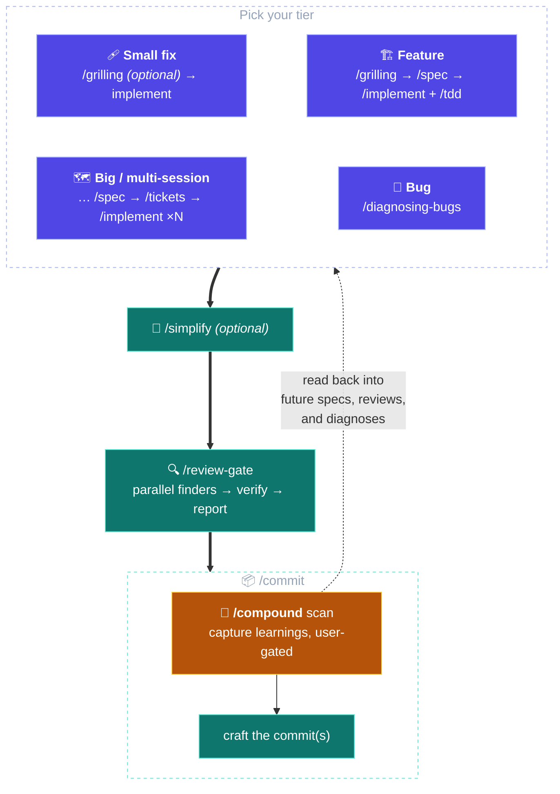
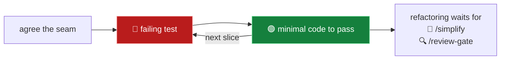
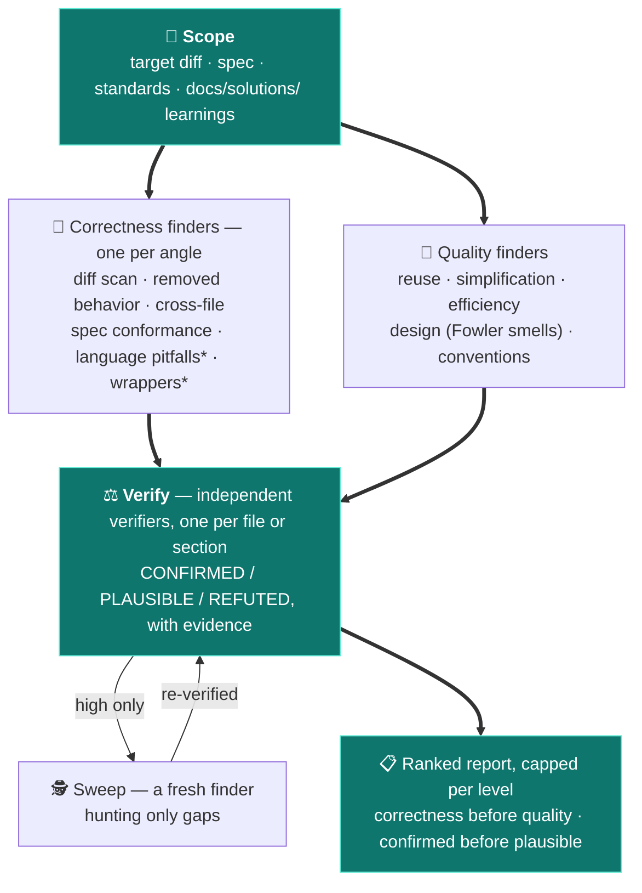
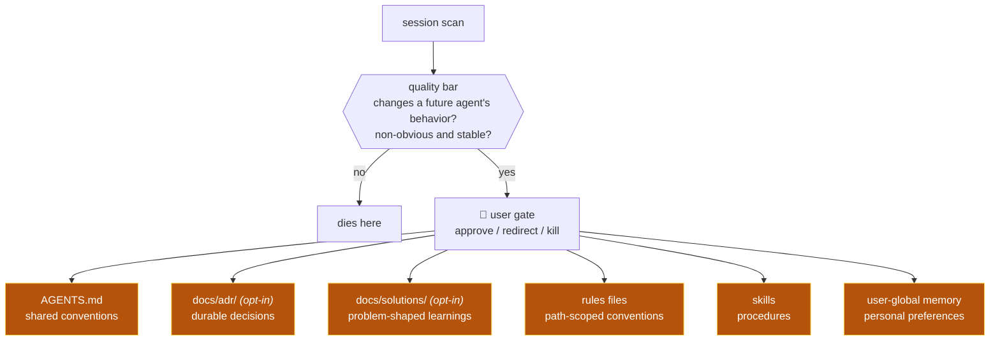
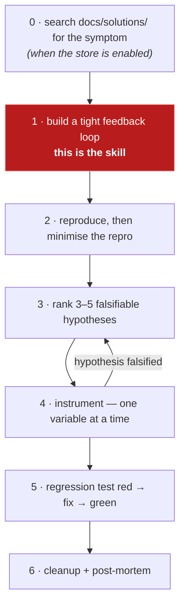

<div align="center">

# 🪄 cantrips

_“Basic spells a caster always has prepared.”_

**A curated set of agent skills for Claude Code and Codex.**

One coherent engineering loop — grill, spec, implement, review, commit — that _remembers what it
learns_ and _runs on without you_ once you delegate. \
And a set of utilities for day to day needs.

Inspired by and kept in sync with [Matt Pocock's skills](https://github.com/mattpocock/skills) and
[Every's Compound Engineering](https://github.com/EveryInc/compound-engineering-plugin).

[Why cantrips](WHY.md) · [The loop](#a-loop-that-navigates-itself) ·
[The skills](#the-loop-skill-by-skill) · [Storage](#pluggable-storage) · [Install](#install) ·
[Development](#development)

</div>

---

Most skill collections are a bag of independent commands: you memorize which one to type, and each
one starts from nothing. Cantrips is a single pipeline instead — `/grilling` → `/spec` →
`/implement` (TDD at agreed seams) → `/review-gate` → `/commit` → `/compound` — folding the best of
both upstreams into one shape: **Pocock to steer, a Compound-Engineering-style pipeline to execute
and remember.**

## A loop that navigates itself

Cantrips is not a bag of independent commands — it is one dynamic, discoverable loop:

- **Every pipeline skill ends by naming the next step** and whether to take it in this session or
  break to a fresh one, so you never memorize the pipeline — the loop tells you where you are.
- **Two invocation modes.** Deliberate gates (🧑) only fire when you type them; reflexes (🤖) fire
  on their own when their triggers match — `/tdd` when you build test-first, `/compound` when a
  learning surfaces, `/prototype` when a state model needs pushing through real cases.
- **Skills brief each other.** The spec records the seams `/tdd` will bite at; `/implement`
  suggests a `/review-gate` effort level scaled to the diff it just produced; `/review-gate` flags
  compound-worthy findings for `/commit`'s learnings scan.
- **Storage is pluggable.** Skills speak six storage verbs, never a path or a CLI. Local markdown
  out of the box; a GitHub tracker, or your own described workflow, once you configure one.
- **The loop remembers.** `/compound` routes what a session learned into knowledge stores, and
  `/spec`, `/review-gate`, and `/diagnosing-bugs` read those stores back — each unit of work makes
  the next one easier.
- **The loop runs without you.** `/deputy` engages a stand-in that answers every round, gate and
  closing in your place — the product's CTO to your CEO — and hands back only the decisions you
  kept, so the calls from interview to tickets get made while you are away, and you only type
  each next step.

## The tiers

Each tier only adds ceremony when the work warrants it:



- **Small fix:** `/grilling` (optional) → implement directly → `/review-gate` → `/commit`.
- **Feature:** `/grilling` → `/spec` → `/implement` in a fresh context, driving `/tdd` at the test
  seams agreed in the spec → [`/simplify`] → `/review-gate` → `/commit`.
- **Big / multi-session:** insert `/tickets` between spec and implement; one ticket per fresh
  context window.
- **Bugs** enter through `/diagnosing-bugs` instead of grill/spec; the root cause becomes a
  learning at commit time.
- `/deputy` carries any tier through its rounds, gates and closings while you are away.
- `/handoff` breaks context at any tier (compaction for resuming — never a substitute for a spec).
- A closing that points into `/simplify` or `/review-gate` recommends compacting the conversation
  first: a full pass rarely fits one context window, and only you can see how full yours is.

## Pluggable storage

No skill hard-codes where a spec or a ticket lives. The storage-touching skills speak **six
verbs** — _publish_, _fetch_, and _annotate_ the spec; _publish_, _fetch_, and _resolve_ the
ticket — and one per-repo doc, `docs/agents/cantrips-loop.md`, translates each verb for the repo's
backend and lists which knowledge stores are enabled. When that doc is absent, the plugin's defaults
govern, so a bare install runs with no configuration step.

What lives where, by default:

| Artifact  | Default home                                  | Role                                                                           |
| --------- | --------------------------------------------- |--------------------------------------------------------------------------------|
| Specs     | `.scratch/<feature>/spec.md`, gitignored      | Point-in-time record of one feature's decisions; deleted at feature close.     |
| Tickets   | `.scratch/<feature>/NN-<slug>.md`, gitignored | Execution slices of a spec; resolved by `/implement`, deleted with it.         |
| ADRs      | `docs/adr/`, committed — **opt-in**           | Durable decisions with supersession chains; `/compound` writes, `/spec` reads. |
| Solutions | `docs/solutions/`, committed — **opt-in**     | Problem-shaped learnings; re-read by reviews and diagnoses.                    |

> [!IMPORTANT]
> Nothing breaks without it, but one [`/setup-cantrips-loop`](#setup-cantrips-loop) run per repo is
> what makes the loop *remember*: on the bare defaults both knowledge stores stay **off**, so the
> loop executes and never accumulates decision memory. The same run picks the storage backend —
> committed specs, or a tracker, instead of scratch.

### Three backend seeds

- **Local markdown** — the defaults above, written into the doc; the setup run can instead pick
  a committed location (e.g. `docs/specs/`) for repos whose specs should travel with branches,
  worktrees, and pull requests.
- **GitHub** — the `gh` CLI: the spec and each ticket published as issues, annotations as issue
  comments, ticket resolution as an issue close, blocking edges via native issue links.
- **Freeform** — describe your tracker workflow in a paragraph; the setup skill derives each
  verb's translation from it.

### Specs are point-in-time records

A spec's body **freezes once implementation starts**: work-status lines (pending, in-progress,
done) never enter it — execution state lives in git and in the backend's own machinery. Until
then, and only in the session that published it, a correction you ask for rewrites the body, and
any ticket already cut from it. Afterthoughts — a `/prototype` verdict, a decision revised
mid-implementation — arrive as **dated annotations** through the annotate-spec verb, so the
original decision and its revisions stay distinguishable.
Post-loop drift between spec and code is not an error: code and git are truth, the spec is
history. And no skill ever closes a spec — closing a feature is your act through the backend's
native machinery (one click on a tracker; on local markdown, deleting the feature's `.scratch/`
folder — the durable outcome lives in code, git, and the knowledge stores, not the spec).

### Two opt-in knowledge stores

The stores are the loop's memory — the durable layer that outlives disposable specs — and skills
skip reads and writes against a store that is off. **`docs/adr/`** gives decisions history
instead of silent drift: an outdated record names the record that replaced it, and every write
passes `/compound`'s user gate. **`docs/solutions/`** captures root cause, gotcha, and what
didn't work, so the next session that hits the same problem starts from the answer.
[The compounding system](#the-compounding-system) below shows how both are written and read back.

## The compounding system

The part that makes each unit of work easier than the last:

- **`/compound`** fires inside `/commit`'s opening scan (or typed ad-hoc, or agent-fired when a
  learning surfaces mid-session), scans the session for learnings that would change a future
  agent's behavior — non-obvious and stable ones only — and routes each to the right store: the
  project's `AGENTS.md`, a `docs/adr/` decision record, a `docs/solutions/` entry, a rules file,
  a skill, or your user-global memory file (`CLAUDE.md`, `AGENTS.md`, or your harness's
  equivalent). The two opt-in stores take writes only where the repo enables them. **Every write
  is gated**: you or your deputy approve, redirect, or kill.
- **Read-back arrows:** `/spec` reads the repo's decision memory — `AGENTS.md`, plus ADRs for
  decisions already made and solutions for gotchas where those stores are enabled (never past
  specs) — and `/review-gate` and `/diagnosing-bugs` re-check `docs/solutions/` learnings when
  that store is on, so captured knowledge actually gets used.
- **`/compound-refresh`** garbage-collects the stores when they age: audits `AGENTS.md` for
  bloat and contradictions, plus `docs/solutions/` against the current code when that store is
  enabled. (`docs/adr/` needs no collection — supersession is its own hygiene.)

## The loop panel

Claude Code 2.1.310 or later draws the loop beside the chat: cantrips ships a mod, a pane that opens
on its own when a session starts in a repository that runs the loop (one holding the loop config or
a feature under `.scratch/`), in a terminal wide enough for an unasked pane (144 columns). It shows
the loop rail with the current stage lit and the stages visited marked, the feature the session
works on with its spec, its annotation count and its ticket board (number, title, blockers,
resolution, criteria ticked over all, the current ticket lit), and a reserved "Needs you" row that
is not wired yet. Claude tells the mod which feature and ticket it is on through a tool the mod
registers in a repository that runs the loop, `mcp__cantrips__loop`. The tool's description says
when to call it, so no skill mentions it. Until the first call the pane shows no feature; a resumed
session is the exception and gets back the feature and ticket it last held. A chip above the prompt
carries the stage and the lit ticket over the ticket count; a click on it, its hotkey while the band
has focus, or `/cantrips` opens the pane, and `/cantrips` toggles it. A pane you close stays closed
for that session, through `/clear` and a resume; the next session opens it again.

The pane also lists the features in flight under `.scratch/`: the stage each reached, when it was
last touched, whether its spec and tickets exist, and its last ticket while that one is still
unresolved or its review is under way. A feature that another session worked on last has a Resume
button, which runs `/resume` with that session's id; if Claude Code refuses the call, the command
goes into the prompt instead.

During a `/review-gate` run the pane shows what the run's state file holds. The headline gives the
phase the script recorded (reviewing, fixing, waiting on you, green or stopped) and the round; a
one-shot run that has finished reads reported, or, under `--fix`, fixed once a finding came out
fixed, needing no change, or routed. Below it come the level, the flag the run was given and the
target. In a run that applies fixes, a bar splits the findings by where they stand, and the counts
under it read as its legend: done, skipped, open, queued, and the arbiter's declines last. Up to
five findings parked for you are listed with their summaries and the rest counted, the queue shows
as many ids as fit on one line, and the verdict counts close the section, so however many findings a
run holds, the section never grows past five parked rows and one line of queue. When a stop trips,
the pane says why in plain words, and once the run has stopped on it, the pane names the command
that continues it. The mod takes the file's path from the line the script prints when the run starts
and stores it, so a resume finds the run again. A session that joined a run midway, or was cleared
after the run started, shows no gate. The status line under the prompt shows a run that has stopped
or is waiting on you, and clears when the script records another phase. The chip adds one word on
the gate: that the run stopped, how many findings are for you, that the run is green, or how many
are queued or open.

The pane shows the session's cantrips sub-agents. While a batch of finders or verifiers runs, it
gets a row of one mark per agent, finished ones first, so the row fills up as the batch works, with
a done count and the batch's elapsed time. Once spawned, the arbiter keeps a row with its elapsed
time while it runs and its duration once done, until Claude Code stops listing it. The deputy always
has a row. It reads `off` until `/deputy` engages one, then `deciding mode` or `advising mode`,
which Claude reports through the same tool, and `dismissed` once sent away. Its right end says
`idle` between answers and shows the elapsed time while it answers. Pressing a row opens that
agent's conversation in the main view and marks the row, and `◀ main` brings you back. A deputy
Claude Code no longer lists can't be pressed, and if Claude Code refuses a switch anyway, the pane
says why under the row. The rows reset on `/clear` and on a resume. The chip adds the number of
running agents.

While the session works on a feature, the mod adds a keep list to the instructions of every
compaction, automatic ones included, after anything you typed with `/compact`. The list gives the
paths of the feature's spec and current ticket, the stage, any `/review-gate` run with the findings
parked for you (and the command that continues the run once it has stopped), and the deputy's
mode. It also asks the summary to keep your intent for the diff, the decisions and their reasons,
what was ruled out, and the open questions.

Everything the pane shows comes from the files the loop writes, the events the engine fires and the
calls to its tool; it reads nothing from the chat, and a section nothing can fill stays absent. The
mod reads files, listens to events and draws. It acts on the session only when you press one of its
buttons, except for the keep list it adds to each compaction. It writes only its own store,
registers no permission-deciding hook, fetches nothing, and passes on every tool call except those
to its own tool. `claude plugin validate` lists every engine call it makes.

The mod API is early access and changes between Claude Code releases. A release that breaks the
pane leaves the skills loading, since the module loads apart from them, and the fix ships as a
plugin release. An older Claude Code loads the skills with no plugin error and draws nothing;
Codex CLI has no mod API and gets the skills alone.

## Full roster

Each skill name links to its section below; each skill's `SKILL.md` under
[skills/](skills/) is the authoritative source. 🧑 you type it;
🤖 the agent loads it on its own when its triggers match (agent-invokable skills show both — you
can still type them).

**The loop:**

| Skill                                  | Invoked by | Role                                                                         |
| -------------------------------------- | ---------- | ---------------------------------------------------------------------------- |
| [`/grilling`](#grilling)               | 🧑🤖       | Relentless round-by-round interview to stress-test the plan.                 |
| [`/spec`](#spec)                       | 🧑         | Publish the conversation as a spec, test seams included.                     |
| [`/tickets`](#tickets)                 | 🧑         | Slice a big spec into tracer-bullet tickets, one per fresh context.          |
| [`/implement`](#implement)             | 🧑         | Execute the spec or one ticket, driving `tdd` at the agreed seams.           |
| [`/tdd`](#tdd)                         | 🧑🤖       | Red-green-refactor discipline, with its anti-patterns catalogue.             |
| [`/simplify`](#simplify)               | 🧑         | Optional preserving quality pass before review.                              |
| [`/review-gate`](#review-gate)         | 🧑         | The gate: effort-scaled finder angles, every finding independently verified. |
| [`/commit`](#commit)                   | 🧑         | Scan the session for learnings, then craft the commit(s).                    |
| [`/compound`](#compound)               | 🧑🤖       | Route each learning to the right store, gated on you or your deputy.         |
| [`/diagnosing-bugs`](#diagnosing-bugs) | 🧑🤖       | The bug entry point: diagnosis loop replacing grill/spec.                    |
| [`/deputy`](#deputy)                   | 🧑         | Answer in your place for the rest of the session: the loop, unattended.      |

**The utilities:**

| Skill                                                              | Invoked by | Role                                                                       |
| ------------------------------------------------------------------ | ---------- | -------------------------------------------------------------------------- |
| [`/setup-cantrips-loop`](#setup-cantrips-loop)                     | 🧑         | Configure a repo's storage backend and opt-in knowledge stores.            |
| [`/setup-git-guardrails`](#setup-git-guardrails)                   | 🧑         | Install a hook that blocks dangerous git commands before they run.        |
| [`/compound-refresh`](#compound-refresh)                           | 🧑         | Garbage-collect `AGENTS.md`, and `docs/solutions/` where enabled.          |
| [`/handoff`](#handoff)                                             | 🧑         | Compact the session into a handoff for a fresh context.                    |
| [`/wait-what`](#wait-what)                                         | 🧑         | Interrupt: re-pitch a message that did not land.                           |
| [`/afk`](#afk)                                                     | 🧑         | Keep the session's prompt cache warm across a break.                       |
| [`/prototype`](#prototype)                                         | 🧑🤖       | Throwaway prototype to answer a design question empirically.               |
| [`/research`](#research)                                           | 🧑🤖       | Background primary-source research, captured in the repo.                  |
| [`/questionnaire`](#questionnaire)                                 | 🧑         | Draft a questionnaire pulling knowledge out of another person.             |
| [`/resolving-merge-conflicts`](#resolving-merge-conflicts)         | 🧑🤖       | Principled merge/rebase conflict resolution.                               |
| [`/codebase-design`](#codebase-design)                             | 🧑🤖       | Deep-module vocabulary other skills lean on.                               |
| [`/improve-codebase-architecture`](#improve-codebase-architecture) | 🧑         | Scan for module-deepening opportunities.                                   |
| [`/teach`](#teach)                                                 | 🧑         | Learn a concept from this workspace, tutor-style.                          |
| [`/writing-for-agents`](#writing-for-agents)                       | 🧑🤖       | The authoring standard, loaded before editing skills, AGENTS.md, or rules. |

## The loop, skill by skill

### `/grilling`

**A relentless interview that stress-tests a plan before any code exists.**

- **When to use** — before `/spec` on anything non-trivial, or whenever a decision deserves
  pressure. Fires on its own when you ask to be grilled or requirements are fuzzy.
- **The intent** — agents default to agreeable: they fill gaps with silent assumptions and build
  the wrong thing confidently. Grilling inverts the posture. Facts are looked up in the
  environment, by background sub-agent where one is needed; _decisions_ are yours.
- **How it works** — the interview runs in **rounds** over a decision tree. Each round asks the
  whole **frontier** — every question whose prerequisites are already settled — numbered, each with
  a recommended answer. Your answers push the frontier outward and the next round follows. A
  frontier fact that lives in external docs routes to `/research`. The interview closes when the
  frontier is empty.
- **Next** — `/spec` for feature-sized outcomes (same session — it synthesizes the interview),
  `/implement` directly for small fixes; `/prototype`, `/research` or `/questionnaire` where a
  question survived the interview and needs evidence, primary sources, or knowledge only another
  person holds.

### `/spec`

**Synthesize the conversation into a published spec — the contract `/implement` executes and
`/review-gate` reviews against.**

- **When to use** — feature-sized work, once the decisions exist (usually right after `/grilling`).
- **The intent** — decisions decay in chat logs; a spec survives the session. It records the
  **test seams** you approve up front, so implementation can TDD without relitigating design, and
  its requirements are what the review gate's spec angle later checks the diff against.
- **The lifecycle** — a spec is a **point-in-time decision record**: body frozen once
  implementation starts, afterthoughts as dated annotations — see
  [Pluggable storage](#pluggable-storage).
- **How it works** — explores the repo and reads the decision memory (`AGENTS.md`, plus ADRs and
  solutions where those stores are enabled — never past specs). It then stops up to twice, each
  time on a numbered round of questions with a recommended answer. Before drafting: every
  standing ADR the design touches — keep, revise or retire, the ones it judges compatible
  included — together with the proposed seams. After drafting: a sub-agent rereads the draft
  against what you actually decided and against the code, the agent corrects what needs no call
  from you, and only what is left comes back as questions. The spec is published once, after
  that: problem, solution, user stories, implementation decisions, test seams, out of scope. A
  conversation holding no design decisions gets `/grilling` recommended instead.
- **Next** — `/tickets` when the work spans sessions, else `/implement` — a fresh context either
  way; the spec _is_ the context.

### `/tickets`

**Slice a big spec into tracer-bullet tickets, one per fresh context window.**

- **When to use** — the spec is too big for one session.
- **The intent** — context windows are the real budget. Each ticket is a **vertical slice**
  (schema to UI to tests) that lands demoable and green on its own; **blocking edges** between
  tickets expose which ones can start immediately. Wide mechanical refactors get expand–contract
  sequencing instead of a forced vertical cut.
- **How it works** — drafts the slices, quizzes you on granularity and edges until you approve,
  then publishes one ticket per slice, numbered in dependency order, with acceptance criteria —
  blocking edges ride the backend's native issue links where it has them, prose otherwise.
- **Next** — `/implement`, one ticket per fresh context, working the frontier of unblocked
  tickets.

### `/implement`

**Execute the spec or one ticket, driving `/tdd` at the agreed seams.**

- **When to use** — a fresh session holding a spec or ticket.
- **The intent** — deciding and building are separated on purpose: the spec already carries the
  decisions and the approved seams, so implementation tests at them without re-asking, and states
  explicit verification criteria wherever no seam was agreed.
- **How it works** — fetches the spec or ticket in full, drives `/tdd` at the agreed seams,
  typechecks and runs scoped tests continuously, ticks acceptance criteria as each is verified,
  and finishes with the full suite. A ticket whose criteria are all verified is **resolved**
  through the backend (a wrong resolve is one human reopen away); the spec itself is never
  closed.
- **Next** — `/simplify` (optional), then `/review-gate` with a suggested effort level scaled to
  the diff it just produced, then `/commit` — all in-session; the working diff is the context.

### `/tdd`

**The red → green loop, plus the reference that makes it produce tests worth keeping.**

- **When to use** — building features or fixing bugs test-first. Fires on its own when you mention
  red-green-refactor or test-first work.
- **The intent** — agent-written test suites rot in three named ways the skill blocks:
  **implementation-coupled** tests that break on refactor, **tautological** assertions that
  recompute the expected value the way the code does, and **horizontal slicing** (all tests first,
  then all code) that verifies imagined behavior. Tests live only at **seams** you agreed — via
  the spec, or confirmed before the first test — so effort lands on critical paths.



- **Next** — refactoring is deliberately not part of the cycle; it belongs to the review tail,
  `/simplify` and `/review-gate`.

### `/simplify`

**An optional quality pass between implementation and review that changes nothing about what the
material does.**

- **When to use** — the diff works but feels heavier than the problem deserved.
- **The intent** — cleanup and bug-hunting are different jobs; this one only cleans. The three
  mechanical lens finders `/review-gate` runs (reuse, simplification, efficiency) propose fixes;
  every fix must preserve what the material does — exact behavior in code, the whole instruction
  set in agent-facing prose — and **safety checks are never simplified away**, a gate or a
  prohibition in prose counting as one.
- **How it works** — resolves the scope (your words, or the branch diff plus anything uncommitted
  and untracked), dispatches those three plugin agents by name with the scope and the preservation
  contract, applies the worthwhile fixes that fit inside that scope and names the ones it skipped,
  then verifies: typecheck, lint and scoped tests on a code diff, or a re-read confirming every
  instruction survived on a prose-only one.
- **Next** — `/review-gate`, in this session, with a suggested effort level scaled to the diff.

### `/review-gate`

**The gate between implementation and commit: effort-scaled, multi-angle review of the working
diff (or the changes since a fixed point), every finding independently verified.**

- **When to use** — after implementation and the optional `/simplify`, before `/commit`. Pick the
  effort level — upstream skills suggest one scaled to the diff: `low` for a trivial or mechanical
  diff, `high` for a large, cross-cutting, or risky one, `medium` otherwise.
- **The intent** — a single reviewer reading a diff top to bottom misses bugs for two reasons:
  attention dilutes across concerns, and the finder of a candidate bug is a poor judge of it. The
  gate fixes both. **Finders** each hold exactly one concern; **verifiers** judge every candidate
  independently, so a finder never silently drops a bug it half-believes. A dedicated **spec
  angle** compares the diff against the spec's requirements — catching "built the wrong thing
  correctly", which no code-only review can. A code-vs-spec mismatch is reported neutrally with
  both fixes — align the code, or annotate the spec with the mid-implementation revision — because
  a spec is a point-in-time record and the code may be the side that is right. Matched
  `docs/solutions/` learnings (when that store is enabled) are re-checked by every finder, so past
  root causes stay caught.



<sup>\* `high` effort only.</sup>

- **How it works** — four effort levels: `inline` is one diff pass by the session itself, no
  sub-agents and no verifier (≤4 findings); `low` dispatches one finder with the angles and lenses
  the gate picked from the diff's shape, hunted one at a time, then one verifier (≤4); `medium`
  dispatches 4 correctness + 5 quality finders reviewing for **precision** (≤8); `high` dispatches
  6 correctness + 5 quality finders reviewing for **recall**, then a gap-hunting sweep (≤15).
  The finders, the verifier and the arbiter are plugin agents the gate dispatches by name
  (`cantrips:finder:reuse`, `cantrips:verifier`, …), each one's brief, model and background run
  pinned in its definition. On Claude Code they sit in the agent roster and the `@agent-` typeahead
  rather than among the slash commands, and a finder or the verifier can be summoned from there
  directly on a file. Codex plugins carry no agents, so there the skill pastes a definition's body
  into a plain sub-agent. Finders run in parallel; every candidate must name a concrete failure
  scenario.
  Verifiers judge each candidate on its own evidence, and refuted or unverified candidates never
  reach a report above `inline`. At every level, `--fix` applies the surviving findings that fit
  inside the scope it reviewed (a line a confirmed finding cites, or one still naming a symbol the
  diff removed, counts as inside), naming any it had to hand back, and lands a fix to running code
  that answers a correctness finding only once a test or command goes red on the unfixed code.
- **One report format** — a small script shipped with the skill holds the run's findings and prints
  every report, so each run reads the same. Every finding gets an ID like `F3` that you answer by,
  and two short lines: what is wrong, and the failure it causes. After a `--fix` batch the rows
  print again, fixed ones struck through and the rest with why they stay open. A round's findings
  reach you before any of its fixes is written, so you can interrupt one you object to. On Claude
  Code a report followed by more work ends the agent's turn, and a Stop hook the skill registers
  resumes the run on its own; under Claude Code's sandbox with filesystem isolation, the hook cannot
  see the run, so you resume each step yourself. On Codex CLI the agent sends the report as a
  message before its first edit. Where the working tree changed before a report all the same, the
  report says so on its first line. The script needs `node` 22.18 or later; without it, the gate
  refuses to run and says so. Its state lives in the system temp directory, readable only by you, so
  your tree stays clean; a run that applies fixes also writes snapshots of the working tree into the
  repository's object store, with no ref on them, and git prunes them on its own.
- **Converge until green** — `--loop` implies `--fix` at any level and drives the gate instead of
  reporting once: one full-scope certifying pass, then fix batch, project checks, delta re-review
  of exactly what changed since the last review at the level that batch earns (a batch of comments
  runs `inline` whatever level you invoked), repeat, until nothing is left to fix or re-review
  — the arbiter may ask for one more full pass, once. That is green, with the project's checks back
  where they started and every finding explicitly dispositioned: fixed, needing no change, skipped
  with its reason, routed to the spec, or declined by the arbiter.
  Anything needing you is printed in full the moment it is parked, with lettered options and a
  recommendation, and the loop keeps fixing the rest; answer whenever you like (`F4: A, F13: B`)
  and the answer folds in at the next round. Each round prints one header line with the arbiter's
  read of where the run is heading, and the run ends on `GREEN:`, on `WAITING:` when only your
  answers stand between it and green, or on `STOP:` when a guard hands you the wheel: a fix stops
  taking, a question comes back twice, or rounds keep surfacing findings nothing earlier saw and
  leave work standing. Whatever ended it, everything still waiting on you is printed again, and
  answering picks the same run back up.
- **Hands off** — `--fsd`, for full self-driving, implies `--loop` and makes the run yours to come
  back to: every parked question of whether a fix is worth it goes to the arbiter instead of you, a
  code-vs-spec mismatch takes the route the gate recommends, and the run never stops for finding too
  much that is new. Only what you alone can settle still waits on you, printed as before, or goes to
  your deputy where `/deputy` engaged one. Pass it at invocation, or tell a running loop it is hands
  off from here, and it switches over. A spec revision the run annotated is listed in the closing
  report as `/compound` material, so `/commit`'s scan sees it.
- **Held proportionate** — wherever `--fix` or `--loop` applies fixes, an **arbiter** rules beside
  the verifiers: one sub-agent on the harness's most capable model (the session in `inline` runs),
  the long-term maintainer guarding YAGNI and KISS, deciding whether each finding is worth fixing
  _here_. Its ruling binds — a declined finding is skipped with its reason, counted in the report
  and listed when you ask, for you to overrule, and never asked about — and under `--loop` it
  stays alive across rounds, watches how much the fixes have grown the target, and may have an
  overbuilt fix shrunk or backed out. A fifty-line script stays a fifty-line script.
- **Next** — fix what's worth fixing, re-run after substantial fixes, then `/commit`. Findings
  that exposed a durable gotcha are flagged as `/compound` material for commit's opening scan.

### `/commit`

**Close the loop: harvest the session's learnings, then craft the commit(s).**

- **When to use** — the gate has passed and the tree holds the finished work.
- **The intent** — the learnings scan comes _first_ so `/compound`'s approved writes join the
  working tree and ride into the same commit ceremony, instead of dirtying the tree right after
  you committed. Messages communicate value ("why") in a subject of at most 100 characters, follow
  the repo's observed convention, and distinct concerns split into at most two or three file-level
  commits.
- **How it works** — scans the session for compound candidates and invokes `/compound` when any
  might clear its bar; then gathers git context, picks the branch per the repo's workflow,
  matches the message convention, and stages files by name, group by group.
- **Next** — the loop is closed; the next unit of work deserves a fresh session.

### `/compound`

**The loop's memory: capture durable learnings and route each to the right knowledge store, every
write gated on you or your deputy.**

- **When to use** — `/commit`'s opening scan invokes it with candidates; `/diagnosing-bugs` closes
  out through it; it also fires ad-hoc when you ask to capture or remember something.
- **The intent** — automatic memory fails by hoarding trivia. Every candidate faces a two-part
  quality bar — _would it change a future agent's behavior in a different session, and is it
  non-obvious and stable?_ — and session-specific noise dies there. Survivors go to the cheapest
  store that serves them, and nothing is ever written without your approval or your deputy's.



- **Next** — the writes join the working tree; `/commit`'s flow picks them up.

### `/diagnosing-bugs`

**The bug entry point: a feedback-loop-first diagnosis discipline that replaces grill/spec.**

- **When to use** — something is broken, throwing, failing, or slow. Fires on its own on
  "diagnose" or "debug this".
- **The intent** — in the skill's own words, the feedback loop _is_ the skill; everything else is
  mechanical. A **tight**, red-capable, deterministic repro command is built before any theory is
  entertained — jumping straight to a hypothesis is the exact failure the skill prevents — and
  hypotheses are generated 3–5 at a time, each falsifiable, because single-hypothesis debugging
  anchors on the first plausible idea.



- **Next** — `/review-gate` the fix, then `/commit`, whose opening scan turns the root cause, the
  gotchas, and what didn't work into a durable learning — a `docs/solutions/` entry where that
  store is enabled.

### `/deputy`

**A stand-in that runs the loop in your place, or advises while you run it.**

- **When to use** — before stepping away from a feature you have briefed: type it once, with
  standing orders in plain words or nothing at all, and every round, gate and closing a later skill
  would put to you goes to the deputy for the rest of the session. Ask it to advise instead and you
  stay in the chair: the deputy recommends on each and you give every final answer.
- **The intent** — the loop stops for you at every decision round and every closing, so a feature
  you are not sitting beside stalls at the first one. The deputy is a plugin agent,
  `cantrips:deputy`, the product's CTO to your CEO on the harness's most capable model: it takes
  nothing it is handed as given, checks a question's premises against the repo before answering,
  waves a tech lead's question through in a line and spends itself on the ones that shape the
  product. It decides broadly by design — a standing ADR's fate and `/compound`'s gate included, the
  latter under a bar that defaults to no — and hands back only what you kept: the commit, a change
  to what the feature is against your orders or your own answers, anything that commits money, a
  third party or something outside the repo besides your own memory file and personal skills, and a
  taste call your orders do not settle. A hand-back stops the session at once and notifies you where
  the harness can; inside a `--loop` run it parks for you instead and the loop works on.
- **How it works** — every decision gate carries one routing clause that sends the gate to an
  engaged deputy, and its replies are printed verbatim under a header, so the transcript reads as
  an interview you audit by scrolling. In advisor mode one message shows each question with the
  deputy's line under its recommendation, then waits for you. The deputy is dispatched at the first
  round, gate or closing that needs you, onboarded with every round so far, and sits in the agent
  roster as `Deputy`; a context summary loses it, and the session dispatches afresh at its next
  gate. Where the next step it chose is one you type, the session notifies you and waits for the
  keystroke. Answer a round yourself to override that round. A later `/deputy` takes plain words
  too: new orders, a switch between deciding and advising, or a dismissal. Summoned from the agent
  roster instead, it answers one question in a line without engaging.
- **Next** — whatever the deputy chose at the last closing; the loop goes on as if you had
  answered. In advisor mode, the step you picked from its line.

## The utilities, skill by skill

### `/setup-cantrips-loop`

**Configure how a repo runs the loop.** Explains each opt-in knowledge store's role in plain
words and asks which to enable, asks which backend seed translates the six storage verbs — local
markdown, GitHub, or freeform — then writes `docs/agents/cantrips-loop.md`, the one prose doc the
storage-touching skills read in place of the plugin defaults. Re-runnable: a second run edits the
existing doc. Not required to run the loop — but the knowledge stores stay off until it does, so
a repo that never runs it never compounds.

### `/setup-git-guardrails`

**A hook that blocks destructive git commands before they run.** Installs a `PreToolUse` hook —
Claude Code, Codex CLI, or both; this project or every project — that matches each command against
a short list of destructive-git patterns and denies what hits, so the agent is told it has no
authority there instead of you finding out afterwards. The patterns are extended regexes, shipped
narrow and yours to widen at install time to the spellings you actually use. On Codex the hook
stays inert until you trust it under `/hooks`.

### `/compound-refresh`

**Garbage collection for the knowledge stores.** Audits `AGENTS.md` for bloat, contradictions,
and staleness — and, when the solutions store is enabled, every `docs/solutions/` doc against the
current code (cited paths still exist, the fix still matches reality). Verdict per doc — keep,
update, consolidate, or delete — with the prime directive _match docs to reality, never the
reverse_; every change is gated on you or your deputy. Run it when the stores feel stale, not on
a schedule.

### `/handoff`

**Compaction for resuming work.** Writes a handoff document to the OS temp directory — outside the
workspace — that a fresh session can pick up: state, references to specs and commits by path, and
a suggested-skills section naming what the next session should invoke. Deliberately _not_ a spec
substitute: decisions that should outlive the session are annotated onto the feature's spec first.

### `/wait-what`

**The interrupt for a message that did not land.** One canned re-pitch: more context, ASD-STE100
Simplified Technical English — short active sentences, one term per concept — and the project's own
ubiquitous language. Optionally, pass the part that lost you.

### `/afk`

**A keepalive for a session you are coming back to.** Chains self-scheduled wakeups — each one a
tiny "ping" turn on the same prefix, which refreshes the prompt-cache TTL — so a long break ends in
a cache read rather than a full re-encode. Fifty minutes apart, capped at ten. Session-scoped, so
closing the window ends the loop too.

> [!IMPORTANT]
> **Claude Code on a subscription plan only.** The fifty-minute interval assumes the one-hour
> prompt-cache TTL a subscription gets; an API-key session caches for five minutes, so every wake
> would land on a dead cache and pay a full write instead of a read. Codex CLI has no in-session
> scheduler.

### `/prototype`

**Throwaway code that answers a design question.** Two branches: a logic question gets a single
shareable HTML file — free-play buttons plus tabbed walkthroughs — that pushes the state model
through hard cases and that a non-developer can drive; a UI question gets radically different
variations switchable on one route. No tests, no polish, no persistence — and when the question is
answered, the validated decision folds into the real code, the prototype itself is committed to a
throwaway branch as a primary source, and the branch pointer and verdict land on the feature's spec
as a dated annotation.

### `/research`

**Background primary-source research.** Spins up a background agent so the session keeps working
while it reads. Official docs, source code, specs — never a secondary write-up — with every claim
cited, captured as a Markdown file where the repo keeps such notes. Fires on its own when a
question hinges on facts living outside the codebase.

### `/questionnaire`

**A document that pulls knowledge out of someone else.** For a decision you can't settle alone
because another person holds the facts: it interviews you about the _send_ — who receives it, what
you need back — never about the subject you don't know, then writes a Markdown questionnaire aimed
at that gap. Most-important-first, one idea per question, answer stubs inline, for filling in async
or together over a meeting.

### `/resolving-merge-conflicts`

**Principled conflict resolution.** Reads the primary sources behind each conflicting change —
commit messages, PRs, the specs fetched through the storage contract — resolves each hunk
preserving both intents where possible, never inventing behavior and never aborting, then runs
the project's checks and finishes the merge or rebase.

### `/codebase-design`

**The deep-module vocabulary the rest of the loop leans on.** Module, interface, seam, adapter,
depth, leverage, locality, the deletion test — used exactly, so design conversations, specs, and
reviews share one language. `/spec` uses it to place test seams, `/review-gate`'s design lens
judges in it, `/improve-codebase-architecture` is built on it. Also carries the deepening playbook
and a design-it-twice pattern that explores alternative interfaces with parallel sub-agents.

### `/improve-codebase-architecture`

**A deepening-opportunity scan.** Walks the codebase's hot spots (recent-change history first),
hunts shallow modules and friction with the deletion test, and presents candidates as a
self-contained HTML report — before/after diagrams, locality/leverage benefits, recommendation
strength. Pick one and it grills you through the redesign decision tree.

### `/teach`

**A tutor that lives in a workspace.** Grounds every lesson in your stated mission, tracks
resources and learning records, and produces short, beautiful, self-contained HTML lessons built
for retention — retrieval practice, spacing, tight feedback loops — with printable reference
sheets as the durable output.

### `/writing-for-agents`

**The authoring standard behind every skill in this repo.** Predictability as the root virtue:
leading words, checkable completion criteria, progressive disclosure, positive phrasing, no
no-ops, prune sediment. Loaded before editing any skill, `AGENTS.md`, or rules file — a session
that only reads them leaves it unloaded.

## Install

Register this repository as a plugin source once, then install cantrips from it.

### Claude Code

```
/plugin marketplace add toverux/cantrips
/plugin install cantrips@cantrips
```

Or from your terminal: `claude plugin marketplace add …` / `claude plugin install …` with the same
arguments.

The [loop panel](#the-loop-panel) needs Claude Code 2.1.310 or later; an older release loads the
skills and skips the panel.

### Codex CLI

```sh
codex plugin marketplace add toverux/cantrips
codex plugin add cantrips@cantrips
```

> The repository is both the source and the only plugin in it, hence `cantrips@cantrips`.

> [!TIP]
> Codex runs three sub-agents at a time by default, so `/review-gate`'s nine to eleven finders run in
> waves. Raise the cap in `~/.codex/config.toml` to have them run at once:
>
> ```toml
> [agents]
> max_threads = 12
> ```

> [!IMPORTANT]
> **Migrating from the upstreams?** Cantrips _replaces_ the Matt Pocock skills and the
> Compound Engineering plugin it forks (renamed: `to-spec` → `/spec`, `ce-commit` → `/commit`,
> `code-review` → `/review-gate`, …). Uninstall those two plugins first, or the duplicate triggers
> will fight each other.
>
> Individual upstream skills can still sit alongside cantrips — install them one at a time, skipping
> the ones cantrips already forks. [FORKS.md](FORKS.md) records which upstream skills are forked and
> which are not ported, so it doubles as the pick list. `wizard`, for instance, is not ported:
>
> ```sh
> npx skills add mattpocock/skills --skill wizard
> ```
>
> Add `-g` to install into your user directory instead of the current project, or copy the skill
> folder into `.claude/skills/` or `.agents/skills/` by hand.

## Development

There is nothing to install and nothing to build — this repository is Markdown, a handful of JSON
manifests, a few dependency-free scripts, and the loop panel's TypeScript, which Claude Code loads
as is. `mise run test` runs two runners: `node --test` over the scripts' tests and the panel's pure
core, then `claude plugin test mod` over the panel's mounted scenarios, which load the module in a
headless engine and need `claude` on PATH. Clone it and edit.

To watch the panel while editing it, `mise run dev:mod-preview` starts a detached tmux session
running Claude Code on the working tree with the mod loaded and the project settings only; the
engine reloads the mod after each save, `tmux attach -t cantrips-mod` shows it, and
`tmux capture-pane -p -t cantrips-mod` reads the pane as text.

See [AGENTS.md](AGENTS.md) for the layout, the authoring standard, and the release process
(release-please). Deferred ideas live in [IDEAS.md](IDEAS.md), and cantrips runs its own loop on
itself — [docs/agents/cantrips-loop.md](docs/agents/cantrips-loop.md) is the config that says how.

### Trying your changes locally

The fastest loop is Claude Code's dev mode — it loads the plugin straight from the working tree,
session-scoped, no install:

```sh
claude --plugin-dir path/to/cantrips
```

To exercise the real install path instead, point the harness at the checkout itself — plain local
paths work in both:

```
/plugin marketplace add path/to/cantrips
/plugin install cantrips@cantrips
```

```sh
codex plugin marketplace add path/to/cantrips
codex plugin add cantrips@cantrips
```

Installs are copies, not links: after editing files, run `/reload-plugins` in a live Claude Code
session, or `/plugin marketplace update cantrips` and reinstall to refresh an install.

An update only refreshes an install when the source advertises a higher version, so unreleased
edits never reach a global install on their own. To dogfood them from your other projects, mirror
the working tree over the installed copies — [mise](https://mise.jdx.dev) has the task:

```sh
mise run dev:sync-install
```

It overwrites the version directory each harness currently holds, the way an install would, and
skips a harness cantrips is not installed in. Then `/reload-plugins` or a new session picks it up,
and a later plugin update restores the released copy.

## License

MIT — see [LICENSE](LICENSE). Forked material is credited in [NOTICE.md](NOTICE.md)
([mattpocock/skills](https://github.com/mattpocock/skills), MIT, © Matt Pocock;
[EveryInc/compound-engineering-plugin](https://github.com/EveryInc/compound-engineering-plugin),
MIT, © Every); every forked skill records its upstream in its frontmatter `source` key, and
[FORKS.md](FORKS.md) records how each fork deliberately differs from its upstream and why.
