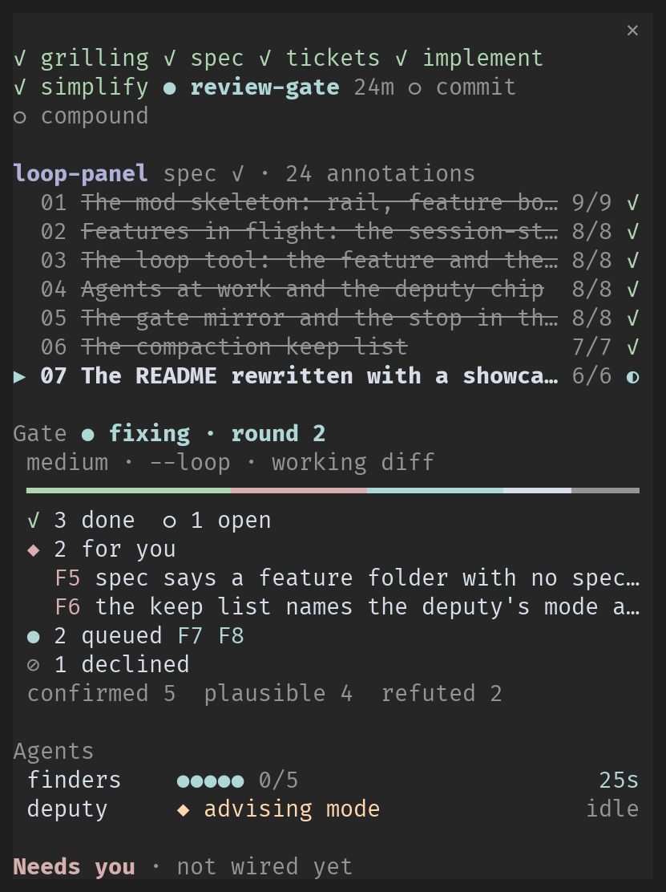
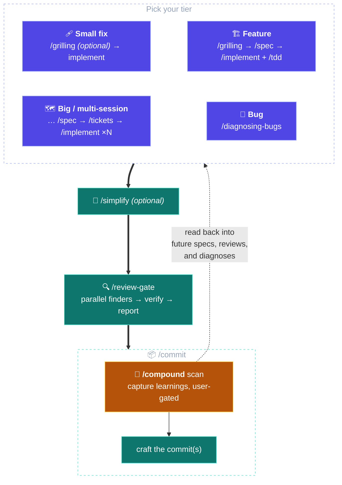
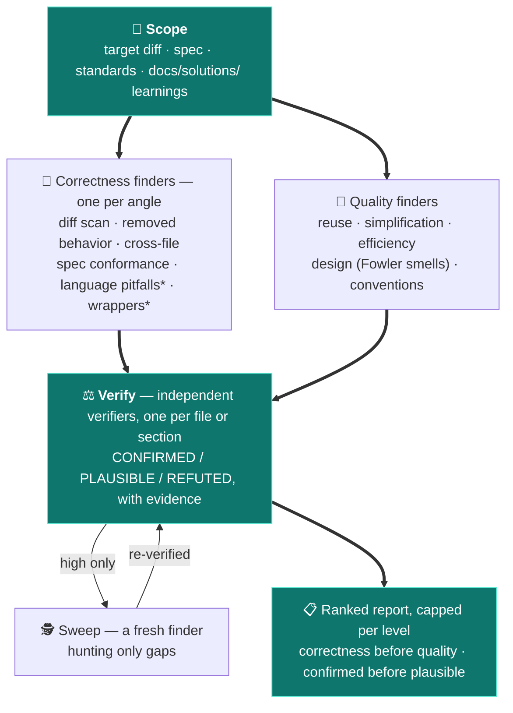

<div align="center">

# 🪄 cantrips

_“Basic spells a caster always has prepared.”_

**A curated set of agent skills for Claude Code and Codex, and a panel that shows the loop they
run.**

One engineering loop (grill, spec, implement, review, commit) that _remembers what it learns_ and
_runs on without you_ once you delegate. \
And a set of utilities for day to day needs.

Inspired by and kept in sync with [Matt Pocock's skills](https://github.com/mattpocock/skills) and
[Every's Compound Engineering](https://github.com/EveryInc/compound-engineering-plugin).

[Why cantrips](WHY.md) · [The loop](#the-loop) · [The panel](#the-loop-panel) ·
[Storage](#storage-and-memory) · [The skills](#the-skills) · [Install](#install) ·
[Development](#development)

</div>

---

Cantrips is one pipeline, `/grilling` → `/spec` → `/implement` (TDD at agreed seams) →
`/review-gate` → `/commit` → `/compound`, built from its two upstreams: Pocock's skills to steer, a
Compound-Engineering-style pipeline to execute and remember. On Claude Code, a pane beside the chat
shows where that loop stands.

<p align="center">
  
</p>

## The loop

- **Every pipeline skill ends by naming the next step** and whether to take it in this session or
  break to a fresh one, so the loop tells you where you are.
- **The loop remembers.** `/compound` routes what a session learned into knowledge stores, and
  `/spec`, `/review-gate` and `/diagnosing-bugs` read them back.
- **The loop runs without you.** `/deputy` engages a stand-in that answers every round, gate and
  closing in your place and hands back only the decisions you kept.

Each tier adds ceremony only when the work warrants it:



`/handoff` breaks context at any point. A closing that points into `/simplify` or `/review-gate`
recommends compacting the conversation first: a full pass rarely fits one context window, and only
you can see how full yours is.

## The loop panel

On Claude Code the pane opens on its own when a session starts in a repository that runs the loop
(one holding the loop config or a feature under `.scratch/`) and the terminal is wide enough (144
columns); close it and it stays closed for the session. It shows the stage rail, the feature's spec
and ticket board and the features in flight under `.scratch/`, the `/review-gate` run and the agents
at work. A Resume button appears where another session last worked on a feature, a gate run stopped
or waiting on you is repeated in the status line under the prompt, and the arbiter's and the
deputy's rows open their conversation.

A chip above the prompt, `🪄 review-gate · 07/7 · 2 for you · 5 running`, keeps the glance when
the pane is hidden or the terminal narrow; it opens the pane and `/cantrips` toggles it. While the
session works on a feature, every compaction carries a keep list the mod builds from the loop's
state.

The pane is built from the files the loop writes, the engine's events and a tool the mod registers
for Claude to report its feature and ticket; it reads nothing from the chat. The mod writes only its
own store, registers no permission-deciding hook, passes every tool call on but its own tool's,
fetches nothing over the network and writes no file in your tree; it acts on the session only when
you press one of its buttons, except for the keep list, and `claude plugin validate` lists every
engine call it makes.

## Storage and memory

No skill hard-codes where a spec or a ticket lives. The storage-touching skills speak **six
verbs** — _publish_, _fetch_, and _annotate_ the spec; _publish_, _fetch_, and _resolve_ the
ticket — and one per-repo doc, `docs/agents/cantrips-loop.md`, translates each verb for the repo's
backend and lists which knowledge stores are enabled. When that doc is absent, the plugin's defaults
govern, so a bare install runs with no configuration step.

| Artifact  | Default home                                  | Role                                                                           |
| --------- | --------------------------------------------- |--------------------------------------------------------------------------------|
| Specs     | `.scratch/<feature>/spec.md`, gitignored      | Point-in-time record of one feature's decisions; deleted at feature close.     |
| Tickets   | `.scratch/<feature>/NN-<slug>.md`, gitignored | Execution slices of a spec; resolved by `/implement`, deleted with it.         |
| ADRs      | `docs/adr/`, committed — **opt-in**           | Durable decisions with supersession chains; `/compound` writes, `/spec` reads. |
| Solutions | `docs/solutions/`, committed — **opt-in**     | Problem-shaped learnings; re-read by reviews and diagnoses.                    |

> [!IMPORTANT]
> Nothing breaks without it, but one [`/setup-cantrips-loop`](#setup-cantrips-loop) run per repo is
> what makes the loop *remember*: on the bare defaults both knowledge stores stay **off**, so the
> loop executes and never accumulates decision memory.

A spec's body **freezes once implementation starts**, and afterthoughts arrive as **dated
annotations**. No skill ever closes a spec; closing a feature is your act through the backend's
native machinery, on local markdown by deleting the feature's `.scratch/` folder.

## The skills

Each skill name links to its section below; each skill's `SKILL.md` under [skills/](skills/) is the
authoritative source. 🧑 you type it; 🤖 the agent loads it on its own when its triggers match
(agent-invokable skills show both: you can still type them).

**The loop:**

| Skill                                  | Invoked by | Role                                                                         |
| -------------------------------------- | ---------- | ---------------------------------------------------------------------------- |
| [`/grilling`](#grilling)               | 🧑🤖       | Relentless round-by-round interview to stress-test the plan.                 |
| [`/spec`](#spec)                       | 🧑         | Publish the conversation as a spec, test seams included.                     |
| [`/tickets`](#tickets)                 | 🧑         | Slice a big spec into tracer-bullet tickets, one per fresh context.          |
| [`/implement`](#implement)             | 🧑         | Execute the spec or one ticket, driving `/tdd` at the agreed seams.          |
| [`/tdd`](#tdd)                         | 🧑🤖       | Red-green-refactor discipline, with its anti-patterns catalogue.             |
| [`/simplify`](#simplify)               | 🧑         | Optional preserving quality pass before review.                              |
| [`/review-gate`](#review-gate)         | 🧑         | The gate: effort-scaled finder angles, every finding independently verified. |
| [`/commit`](#commit)                   | 🧑         | Scan the session for learnings, then craft the commit(s).                    |
| [`/compound`](#compound)               | 🧑🤖       | Route each learning to the right store, gated on you or your deputy.         |
| [`/diagnosing-bugs`](#diagnosing-bugs) | 🧑🤖       | The bug entry point: diagnosis loop replacing grill/spec.                    |
| [`/deputy`](#deputy)                   | 🧑         | Answer in your place for the rest of the session: the loop, unattended.      |

**The utilities:**

| Skill                                                              | Invoked by | Role                                                                       |
| ------------------------------------------------------------------ | ---------- | -------------------------------------------------------------------------- |
| [`/setup-cantrips-loop`](#setup-cantrips-loop)                     | 🧑         | Configure a repo's storage backend and opt-in knowledge stores.            |
| [`/setup-git-guardrails`](#setup-git-guardrails)                   | 🧑         | Install a hook that blocks dangerous git commands before they run.         |
| [`/compound-refresh`](#compound-refresh)                           | 🧑         | Garbage-collect `AGENTS.md`, and `docs/solutions/` where enabled.          |
| [`/handoff`](#handoff)                                             | 🧑         | Compact the session into a handoff for a fresh context.                    |
| [`/wait-what`](#wait-what)                                         | 🧑         | Interrupt: re-pitch a message that did not land.                           |
| [`/afk`](#afk)                                                     | 🧑         | Keep the session's prompt cache warm across a break.                       |
| [`/prototype`](#prototype)                                         | 🧑🤖       | Throwaway prototype to answer a design question empirically.               |
| [`/research`](#research)                                           | 🧑🤖       | Background primary-source research, captured in the repo.                  |
| [`/questionnaire`](#questionnaire)                                 | 🧑         | Draft a questionnaire pulling knowledge out of another person.             |
| [`/codebase-design`](#codebase-design)                             | 🧑🤖       | Deep-module vocabulary other skills lean on.                               |
| [`/improve-codebase-architecture`](#improve-codebase-architecture) | 🧑         | Scan for module-deepening opportunities.                                   |
| [`/teach`](#teach)                                                 | 🧑         | Learn a concept from this workspace, tutor-style.                          |
| [`/writing-for-agents`](#writing-for-agents)                       | 🧑🤖       | The authoring standard, loaded before editing skills, AGENTS.md, or rules. |

### `/grilling`

**A relentless interview that stress-tests a plan before any code exists.** The interview runs in
**rounds** over a decision tree, each round asking the whole **frontier**, every question whose
prerequisites are settled, numbered and each with a recommended answer. Facts are looked up in the
environment, a fact living in external docs routes to `/research`, and _decisions_ are yours. It
closes when the frontier is empty, pointing at `/spec` for feature-sized outcomes or `/implement`
for small fixes.

### `/spec`

**Synthesize the conversation into a published spec — the contract `/implement` executes and
`/review-gate` reviews against.** It reads the decision memory (`AGENTS.md`, plus ADRs and solutions
where those stores are enabled, never past specs) and stops on numbered rounds of questions: before
drafting, on every standing ADR the design touches and the proposed **test seams**; after drafting,
on what a reread of the draft left unsettled. A conversation holding no design decisions gets
`/grilling` recommended instead. Next is `/tickets` when the work spans sessions, else `/implement`,
in a fresh context either way.

### `/tickets`

**Slice a big spec into tracer-bullet tickets, one per fresh context window.** Each ticket is a
**vertical slice** that lands demoable and green on its own, with **blocking edges** exposing which
ones can start at once; wide mechanical refactors get expand-contract sequencing instead. It drafts
the slices, quizzes you on granularity and edges until you approve, then publishes one ticket per
slice, numbered in dependency order, with acceptance criteria.

### `/implement`

**Execute the spec or one ticket, driving `/tdd` at the agreed seams.** The spec carries the
decisions and the approved seams, so implementation tests at them without re-asking and states
explicit verification criteria where no seam was agreed. A ticket whose criteria are all verified is
**resolved** through the backend; the spec itself is never closed. Next is `/simplify` (optional),
then `/review-gate` with an effort level scaled to the diff, then `/commit`, all in session.

### `/tdd`

**The red → green loop, plus the reference that makes it produce tests worth keeping.** The skill
blocks **implementation-coupled** tests that break on refactor, **tautological** assertions that
recompute the expected value the way the code does, and **horizontal slicing** (all tests first,
then all code) that verifies imagined behavior. Tests live only at **seams** you agreed, via the
spec or confirmed before the first test. Refactoring is deliberately not part of the cycle; it
belongs to the review tail.

### `/simplify`

**An optional quality pass between implementation and review that changes nothing about what the
material does.** It dispatches the three mechanical lens finders `/review-gate` runs (reuse,
simplification, efficiency) over the scope (your words, or the branch diff plus anything
uncommitted), applies the worthwhile fixes that fit inside it and names the ones it skipped.
**Safety checks are never simplified away**, a gate or a prohibition in prose counting as one.

### `/review-gate`

**The gate between implementation and commit: effort-scaled, multi-angle review of the working diff
(or the changes since a fixed point), every finding independently verified.** **Finders** each hold
one concern; **verifiers** judge every candidate on its own evidence, so a finder never silently
drops a bug it half-believes. A **spec angle** compares the diff against the spec, catching "built
the wrong thing correctly"; a code-vs-spec mismatch is reported neutrally with both fixes, since the
code may be the side that is right.



<sup>\* `high` effort only.</sup>

- **Four effort levels.** `inline` is one diff pass by the session itself, no sub-agents (≤4
  findings); `low` one finder over the angles the diff's shape calls for, then one verifier (≤4);
  `medium` 4 correctness + 5 quality finders for **precision** (≤8); `high` 6 + 5 for **recall**,
  then a gap-hunting sweep (≤15). The finders, the verifier and the arbiter are plugin agents.
- **`--fix`** applies the surviving findings that fit inside the reviewed scope and names any it had
  to hand back; a fix to running code lands only once a test or command goes red on the unfixed
  code.
- **`--loop`** implies `--fix` and converges instead of reporting once: a certifying pass, then fix
  batch, project checks, delta re-review of what changed, repeat, until nothing is left to fix.
  Anything needing you is printed the moment it is parked, with lettered options and a
  recommendation, and the loop keeps fixing the rest; answer whenever you like (`F4: A, F13: B`).
  The run ends on `GREEN:`, on `WAITING:` when only your answers stand between it and green, or on
  `STOP:` when a guard hands you the wheel; answering picks the run back up. Under the sandbox's
  filesystem isolation you resume each step yourself.
- **`--fsd`**, full self-driving, implies `--loop`: every parked question of whether a fix is worth
  it goes to the arbiter, a code-vs-spec mismatch takes the route the gate recommends, and only what
  you alone can settle still waits on you, or goes to your deputy where one is engaged.
- **The arbiter** rules beside the verifiers wherever fixes are applied, deciding whether each
  finding is worth fixing _here_; its ruling binds, and a declined finding is listed for you to
  overrule.

### `/commit`

**Close the loop: harvest the session's learnings, then craft the commit(s).** The learnings scan
comes _first_ so `/compound`'s approved writes join the working tree and ride into the same commit
ceremony. Messages communicate value in a subject of at most 100 characters, follow the repo's
observed convention, and distinct concerns split into at most two or three file-level commits,
staged by name. The loop is closed; the next unit of work deserves a fresh session.

### `/compound`

**The loop's memory: capture durable learnings and route each to the right knowledge store, every
write gated on you or your deputy.** Every candidate faces a two-part bar: _would it change a future
agent's behavior in a different session, and is it non-obvious and stable?_ Session-specific noise
dies there. Survivors go to the cheapest store that serves them: the project's `AGENTS.md`, a
`docs/adr/` record, a `docs/solutions/` entry, a rules file, a skill, or your user-global memory
file. It fires from `/commit`'s opening scan, from `/diagnosing-bugs`' close, or when you ask to
capture or remember something.

### `/diagnosing-bugs`

**The bug entry point: a feedback-loop-first diagnosis discipline that replaces grill/spec.** A
tight, red-capable, deterministic repro command is built before any theory is entertained, then
hypotheses come three to five at a time, each falsifiable, instrumented one variable at a time. A
regression test goes red, the fix turns it green, and `/commit`'s scan turns the root cause and what
didn't work into a durable learning.

### `/deputy`

**A stand-in that runs the loop in your place, or advises while you run it.** Type it once before
stepping away, with standing orders in plain words or nothing at all, and every round, gate and
closing a later skill would put to you goes to the deputy for the rest of the session; where the
step it picks is one you type, the session notifies you and waits for the keystroke, and a round you
answer yourself stands on your answer. Ask it to advise instead and it recommends on each while you
give every final answer. It decides broadly and hands back only what you kept: the commit, a change
to what the feature is, anything that commits money or a third party, and a taste call your orders
do not settle. A later `/deputy` takes new orders, a switch of mode, or a dismissal.

### `/setup-cantrips-loop`

**Configure how a repo runs the loop.** Asks which opt-in knowledge stores to enable and which
backend seed translates the six storage verbs (local markdown, GitHub through the `gh` CLI, or
freeform), then writes `docs/agents/cantrips-loop.md`. Re-runnable: a second run edits the existing
doc.

### `/setup-git-guardrails`

**A hook that blocks destructive git commands before they run.** Installs a `PreToolUse` hook, in
Claude Code, Codex CLI, or both, for this project or every project, that denies what matches a
short list of destructive-git patterns: extended regexes shipped narrow and yours to widen at
install time. On Codex the hook stays inert until you trust it under `/hooks`.

### `/compound-refresh`

**Garbage collection for the knowledge stores.** Audits `AGENTS.md` for bloat, contradictions and
staleness, and every `docs/solutions/` doc against the current code where that store is enabled.
Each doc gets a verdict (keep, update, consolidate, or delete) under the prime directive _match
docs to reality, never the reverse_, and every change is gated on you or your deputy.

### `/handoff`

**Compaction for resuming work.** Writes a handoff document to the OS temp directory that a fresh
session can pick up: state, references to specs and commits by path, and the skills the next session
should invoke. Not a spec substitute: decisions that should outlive the session are annotated onto
the feature's spec first.

### `/wait-what`

**The interrupt for a message that did not land.** One canned re-pitch: more context, ASD-STE100
Simplified Technical English, and the project's own ubiquitous language. Optionally, pass the part
that lost you.

### `/afk`

**A keepalive for a session you are coming back to.** Chains self-scheduled wakeups fifty minutes
apart, capped at ten, so a long break ends in a cache read rather than a full re-encode. Claude Code
on a subscription plan only; Codex CLI has no in-session scheduler.

### `/prototype`

**Throwaway code that answers a design question.** A logic question gets a single shareable HTML
file that pushes the state model through hard cases and that a non-developer can drive; a UI
question gets radically different variations switchable on one route. When the question is
answered, the decision folds into the real code, the prototype is committed to a throwaway branch,
and the branch pointer and verdict land on the feature's spec as a dated annotation.

### `/research`

**Background primary-source research.** A background agent reads primary sources only, official
docs, source code and specs, and captures the findings with every claim cited as a Markdown file
where the repo keeps such notes, while the session keeps working.

### `/questionnaire`

**A document that pulls knowledge out of someone else.** For a decision another person holds the
facts for: it interviews you about the _send_ (who receives it, what you need back), then writes a
Markdown questionnaire aimed at that gap, most-important-first, one idea per question, answer stubs
inline.

### `/codebase-design`

**The deep-module vocabulary the rest of the loop leans on.** Module, interface, seam, adapter,
depth, leverage, locality, the deletion test, used exactly so design conversations, specs and
reviews share one language; also the deepening playbook and a design-it-twice pattern that explores
alternative interfaces with parallel sub-agents.

### `/improve-codebase-architecture`

**A deepening-opportunity scan.** Walks the codebase's hot spots, hunts shallow modules and friction
with the deletion test, and presents candidates as a self-contained HTML report. Pick one and it
grills you through the redesign decision tree.

### `/teach`

**A tutor that lives in a workspace.** Grounds every lesson in your stated mission, tracks resources
and learning records, and produces short self-contained HTML lessons built for retention, with
printable reference sheets as the durable output.

### `/writing-for-agents`

**The authoring standard behind every skill in this repo.** Predictability as the root virtue:
leading words, checkable completion criteria, progressive disclosure, positive phrasing, no no-ops,
prune sediment. Loaded before editing any skill, `AGENTS.md`, or rules file.

## Install

Register this repository as a plugin source once, then install cantrips from it. `/review-gate`'s
script needs `node` 22.18 or later.

> [!IMPORTANT]
> **Migrating from the upstreams?** Cantrips _replaces_ the Matt Pocock skills and the
> Compound Engineering plugin it forks (renamed: `to-spec` → `/spec`, `ce-commit` → `/commit`,
> `code-review` → `/review-gate`, …). Uninstall those two plugins first, or the duplicate triggers
> will fight each other. Individual upstream skills can still sit alongside cantrips;
> [FORKS.md](FORKS.md) records which are forked and which are not ported, so it doubles as the pick
> list:
>
> ```sh
> npx skills add mattpocock/skills --skill wizard
> ```

### Claude Code

```
/plugin marketplace add toverux/cantrips
/plugin install cantrips@cantrips
```

Or from your terminal: `claude plugin marketplace add …` / `claude plugin install …` with the same
arguments.

The [loop panel](#the-loop-panel) needs Claude Code 2.1.310 or later; an older release loads the
skills and skips the panel. The mod API is early access, so a Claude Code release may break the
panel until the next plugin release.

### Codex CLI

```sh
codex plugin marketplace add toverux/cantrips
codex plugin add cantrips@cantrips
```

Codex CLI has no mod API and gets the skills alone.

> [!TIP]
> Codex runs three sub-agents at a time by default, so `/review-gate`'s nine to eleven finders run in
> waves. Raise the cap in `~/.codex/config.toml` to have them run at once:
>
> ```toml
> [agents]
> max_threads = 12
> ```

## Development

There is nothing to install and nothing to build: this repository is Markdown, a handful of JSON
manifests, a few scripts, and the loop panel's TypeScript, which Claude Code loads as is.
`mise run test` runs the scripts' tests and the panel's; `mise run dev:mod-preview` starts a tmux
session that shows the panel while you edit it, and `mise run dev:mod-shot <out.png>` renders that
pane to an image, which is how the capture above was taken. [AGENTS.md](AGENTS.md) holds the
layout, the authoring standard and the release process, [mod/CLAUDE.md](mod/CLAUDE.md) the panel's,
and [IDEAS.md](IDEAS.md) the deferred ideas; cantrips runs its own loop on itself, and
[docs/agents/cantrips-loop.md](docs/agents/cantrips-loop.md) is the config that says how.

### Trying your changes locally

Claude Code's dev mode loads the plugin straight from the working tree, session-scoped, no install:

```sh
claude --plugin-dir path/to/cantrips
```

To dogfood unreleased edits from your other projects, `mise run dev:sync-install` mirrors the
working tree over the installed copies, and `/reload-plugins` or a new session picks them up.

## License

MIT — see [LICENSE](LICENSE). Forked material is credited in [NOTICE.md](NOTICE.md)
([mattpocock/skills](https://github.com/mattpocock/skills), MIT, © Matt Pocock;
[EveryInc/compound-engineering-plugin](https://github.com/EveryInc/compound-engineering-plugin),
MIT, © Every); every forked skill records its upstream in its frontmatter `source` key, and
[FORKS.md](FORKS.md) records how each fork deliberately differs from its upstream and why.
